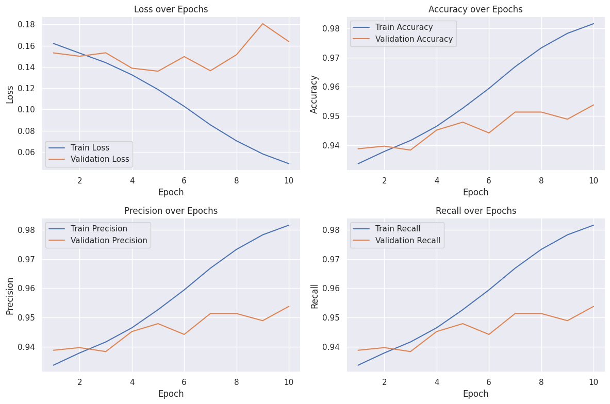
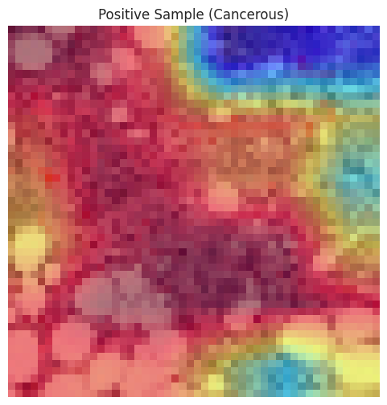
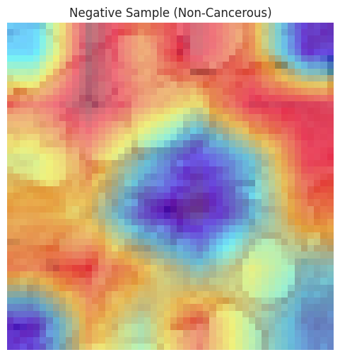

# Breast Cancer Histopathology Image Classification (IDC)

**Phase 2 of an introductory neural networks / computer-vision course project**, using PyTorch convolutional neural networks to classify histopathology image patches as **IDC-positive (`1`)** or **IDC-negative (`0`)**.

> **Scope:** This is binary **patch classification**, not pixel-level breast-tumor segmentation. The Grad-CAM overlays indicate image regions that influenced predictions but are **not segmentation masks**. This is coursework, **not a clinical diagnostic tool**.

The original versions were provided as notebooks and are preserved as output-free source snapshots in [`notebooks/`](notebooks/). The original unmodified notebooks with saved outputs are archived separately in the companion source-backup ZIP rather than committed to this lightweight repository.

## Selected recorded outcomes

These values are **extracted from notebook outputs**, not independently rerun or externally validated.

| Notebook | Recorded test F1 | Recorded test ROC-AUC |
| --- | ---: | ---: |
| `phase2_version1.ipynb` | 0.9175 | 0.9678 |
| `phase2_version2.ipynb` | 0.9488 | 0.9850 |

**Do not interpret this table as a controlled comparison.** The notebooks differ in test-selection logic and the original experiments may share patient images across splits. See [results and limitations](reports/RESULTS.md) and [technical review](docs/REVIEW.md).



## Project contents

| Path | Purpose |
| --- | --- |
| [`notebooks/phase2_version1.ipynb`](notebooks/phase2_version1.ipynb) | Version 1 PyTorch CNN training, testing, Grad-CAM; outputs stripped |
| [`notebooks/phase2_version2.ipynb`](notebooks/phase2_version2.ipynb) | Version 2 with changed evaluation and visualization flow; outputs stripped |
| [`figures/`](figures/) | Figures directly extracted from the supplied version 2 notebook |
| [`references/CI_CNN_Project_Fall_2024_v2.pdf`](references/CI_CNN_Project_Fall_2024_v2.pdf) | Original Persian course assignment, see pages 4-8 for Phase 2 |
| [`docs/DATA.md`](docs/DATA.md) | Dataset acquisition and reproducible split guidance |
| [`docs/PHASE2_REQUIREMENTS.md`](docs/PHASE2_REQUIREMENTS.md) | Phase 2 requirements vs. supplied implementation |
| [`docs/REVIEW.md`](docs/REVIEW.md) | Known research and engineering limitations |
| [`reports/RESULTS.md`](reports/RESULTS.md) | Verbatim saved evaluation values and caveats |
| [`scripts/audit_dataset.py`](scripts/audit_dataset.py) | Local audit for public IDC patch names and patient groups |
| [`scripts/check_notebooks.py`](scripts/check_notebooks.py) | Structural checks without needing the dataset/GPU |

## Data and dependencies

The original notebook references the [Breast Histopathology Images Kaggle dataset](https://www.kaggle.com/datasets/paultimothymooney/breast-histopathology-images). Download the dataset under its own terms, preferably into an ignored local `data/` directory. The training data, checkpoint weights and an extra `new_data` set referenced by the notebooks **were not supplied** and are not redistributed here.

The notebooks were written for a Colab/Kaggle-like Python environment and contain absolute `/content/...` paths, setup cells, and checkpoint references. They are **preserved for fidelity, not promised as reproducible one-click runs**. Before training, adjust the paths in the notebooks and install dependencies:

```bash
python -m venv .venv
source .venv/bin/activate  # Windows: .venv\\Scripts\\activate
python -m pip install -r requirements.txt
jupyter lab notebooks/phase2_version2.ipynb
```

The original code uses **PyTorch**, although the assignment explicitly requests **Keras**. The source code has not been silently converted to Keras or to a segmentation model. Refer to the [requirements mapping](docs/PHASE2_REQUIREMENTS.md).

## Quick checks

```bash
python scripts/check_notebooks.py
python -m unittest discover -s tests -v
python scripts/audit_dataset.py data/IDC_regular_ps50_idx5
```

The last command requires your separately downloaded dataset; it only counts filenames and patient IDs, and does not train a model.

## Saved Grad-CAM examples

| IDC-positive example | IDC-negative example |
| --- | --- |
|  |  |

*These are explanation overlays from the notebook. They do not delineate tumor boundaries.*

## Credits and reuse

Project source: the two supplied Phase 2 notebooks and course specification. See [`CREDITS.md`](CREDITS.md). No repository-wide license is inferred from the supplied source. Dataset and course document retain their respective terms. **Research/educational use only.**
